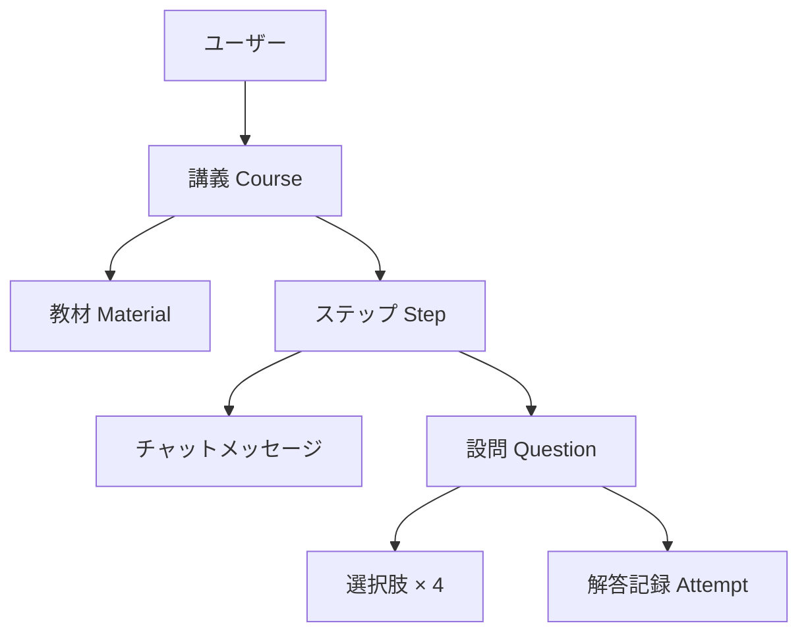

# AI講師 要件定義書

| 項目 | 内容 |
|---|---|
| プロダクト名 | AI講師（仮） |
| 作成日 | 2026-08-26 |
| 最終更新 | 2026-11-09（章ごとにファイルを分割） |
| 作成者 | 平石悠生 |
| ステータス | 本番稼働中。実装に合わせて随時更新する（開発状況は [PROGRESS.md](PROGRESS.md)） |

## 目次

章番号（§）はファイルを分けても変えない。コードのコメントは `§4.1.2` のように番号で参照しているため、
番号を振り直すと参照が壊れる。§12 を Appendix（§11）の後ろに置いているのも同じ理由である。

| 章 | ファイル | 内容 |
|---|---|---|
| §1 概要 | このファイル | 目的・課題・前提となる方針決定・スコープ |
| §2 用語定義 | このファイル | 教材・講義・ステップ・骨子などの定義 |
| §3 画面構成 | [requirements/screens.md](requirements/screens.md) | 画面一覧（SC-xx）と各画面の仕様 |
| §4 機能要件 | [requirements/features.md](requirements/features.md) | 講義作成・受講・確認テスト・教材・講義管理・認証・管理ページ・使い方ガイド |
| §5 AI仕様 | [requirements/ai.md](requirements/ai.md) | ①〜⑤の呼び出し、プロンプトの要件、モデル選定、エラー処理 |
| §6 データモデル | [requirements/data.md](requirements/data.md) | ER図・テーブル定義・主要クエリ・インデックス |
| §7 技術選定 | [requirements/tech.md](requirements/tech.md) | 構成・Cloudflare の採用理由・Workflows・CSR |
| §8 非機能要件 | [requirements/non-functional.md](requirements/non-functional.md) | 性能・コストと上限・セキュリティ・運用・アクセシビリティ |
| §9 画面遷移図 | [requirements/screens.md](requirements/screens.md) | §3 と同じファイルの末尾 |
| §10 決定事項・未決事項 | [requirements/decisions.md](requirements/decisions.md) | Q-xx ごとの論点・決定・根拠 |
| §11 将来拡張 | [requirements/future.md](requirements/future.md) | MVP の対象外とした項目、AIプロバイダの比較 |
| §12 API仕様 | [requirements/api.md](requirements/api.md) | エンドポイント一覧・認証・エラー・ストリーミング |

---

## 1. 概要

### 1.1 目的

ユーザーが所有する参考書・講義資料（Markdown形式のテキスト）をアップロードすると、AIがその内容を学習に適したステップへ分解し、チャット形式の講義として順に解説する。各ステップの理解度は選択式の確認テストで測定し、誤答した問題のみを再挑戦できる。

「読む」だけで終わりがちな参考書を、「解説される → 質問できる → 測定される」という能動的な学習サイクルに変換することを目的とする。

### 1.2 解決する課題

| # | 課題 | 本プロダクトでの解決 |
|---|---|---|
| C-1 | 参考書は情報が線形に並んでおり、どこから何をどの順で学ぶべきかが自明でない | AIが依存関係を考慮してステップへ分解し、順序と学習目標を提示する（§4.1、§5.2） |
| C-2 | 読んでいる最中に生じた疑問を、その場で解消できない | 講義チャット内で随時質問でき、教材の該当箇所を根拠に回答する（§4.2.4） |
| C-3 | 読んだつもりでも定着したかを客観的に測れない | ステップ単位の4択確認テストで測定する（§4.3） |
| C-4 | 誤った箇所を後から効率的に復習できない | 正誤を永続化し、誤答問題のみを抽出した復習モードを提供する（§4.3.4） |
| C-5 | 現在どこまで進んだかを見失う | 講義中は進捗状況パネルで全ステップと現在地を常時表示する（§4.2.3） |

### 1.3 ターゲットユーザー

- 主：自習用の技術書・大学の講義資料を持ち、独学で進めている大学生・社会人
- MVPにおける想定利用者数：本人を含む数名（§1.5）

### 1.4 前提となる方針決定

本要件定義に先立ち、以下を確定した。

| 決定事項 | 選択 | 理由 |
|---|---|---|
| アーキテクチャ | BFF（サーバー側）＋ DB ＋ 認証 | AIのAPIキーをブラウザに露出させないため。またワイヤーフレームがユーザーアカウント表示を含み、講義・進捗の永続化と端末間継続を前提としているため |
| スコープ | 個人利用のMVP | 不特定多数への公開に伴う課金・レート制限・法務要件を初版から抱え込まない。将来拡張は §11 に隔離 |
| 講義生成タイミング | 作成時に「骨子＋確認テスト」、講義本文は進行に合わせて逐次生成 | 初回待ち時間を短縮し、かつ未読ステップ分のトークン消費を避ける。同時に、確認テストは講義全体を俯瞰した状態で生成することで重複と網羅性の破綻を防ぐ |
| AI実行基盤 | **Gemini API ＋ APIキー**（従量課金） | 本アプリのコストは「教材10万トークンを毎ターン読む」部分が支配的であり、キャッシュ読み取り単価とキャッシュ書き込み単価で決まる。Gemini はこの2つが他社より大幅に安く、講義1件あたりの想定コストが約 $0.9 と、Claude 構成の約 $4.5 に対して1/5になる。単一プロバイダに揃えることで SDK・認証・エラー処理・構造化出力の書式がいずれも1系統で済む点も採用理由。比較の詳細は §11.3.1 |
| 確認テストの選択肢数 | 4択 | 当初案の8択は誤答選択肢（ディストラクタ）を7つ生成する必要があり、埋め草的な選択肢が混入して実質的な難易度が下がるリスクが高いため、4択に変更した |

### 1.5 スコープ

**MVPに含む**

- Markdown教材のアップロードとプレビュー
- 講義に紐づく教材原文の閲覧（読み取り専用）
- 講義（コース）の生成、一覧表示、切替
- チャット形式の講義進行、および質問応答
- 進捗状況の表示と永続化
- 4択確認テスト、正誤記録、誤答のみの復習モード
- 単一ユーザーを識別するための認証

**MVPに含まない**（§11 で扱う）

- PDF・画像・URLからの教材取り込み
- 記述式・穴埋め等、選択式以外の出題形式
- 講義内容の手動編集
- 他ユーザーとの講義共有、公開
- 課金
- 学習履歴の統計ダッシュボード、忘却曲線に基づく復習スケジューリング

初版では利用量制限と管理画面も対象外としていたが、その後、月間上限（§8.2.3）と読み取り専用の
運営管理ページ（§4.7）を追加した。

---

## 2. 用語定義

| 用語 | 定義 |
|---|---|
| **教材**（Material） | ユーザーがアップロードしたMarkdown原文。1つの講義に1つ紐づく |
| **講義**（Course） | 1つの教材から生成された学習単位。サイドバーの一覧に並ぶ要素（例：「Git入門」）。ステップ群と確認テストを内包する |
| **ステップ**（Step） | 講義を分解した学習単位。進捗状況パネルの各項目（例：「基本コマンド」「ブランチ」）に対応する。順序と学習目標を持つ |
| **骨子**（Outline） | 講義の全ステップ定義（タイトル・学習目標・要点・教材該当範囲）の集合。講義作成時に一括生成される |
| **講義本文**（Lecture Body） | 各ステップの解説メッセージ。ステップに到達した時点で生成される |
| **確認テスト**（Quiz） | ステップに紐づく4択問題の集合 |
| **設問**（Question） | 確認テストを構成する個々の問題。問題文・4つの選択肢・正解・解説から成る |
| **解答記録**（Attempt） | ユーザーが設問に回答した1回分の記録。選択した選択肢と正誤を持つ |
| **復習モード** | 過去に誤答した設問のみを抽出して出題するモード |

### 2.1 用語の階層関係

