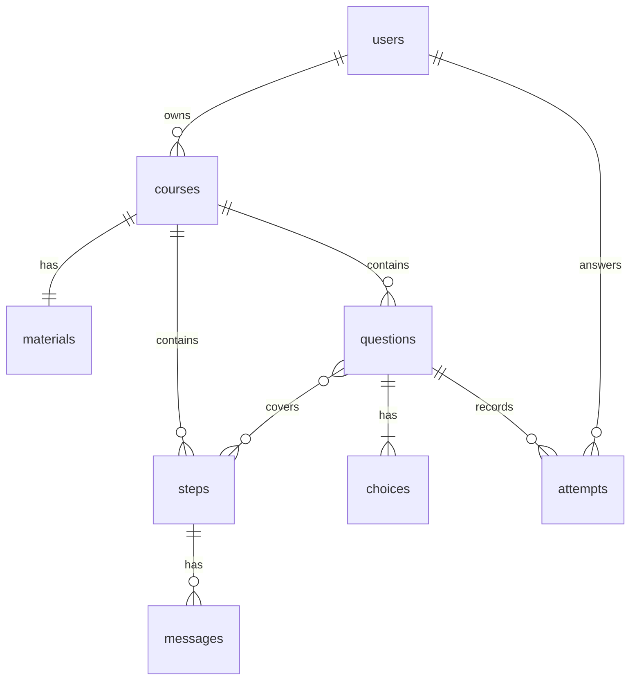

# 要件定義書：データモデル（§6）

[目次へ戻る](../REQUIREMENTS.md)

## 6. データモデル

### 6.1 ER図

### 6.2 型の方針（D1 / SQLite）

DBに D1 を採用したため、SQLite の型に合わせる。以下は全テーブル共通の方針である。

| 論理型 | D1 での型 | 備考 |
|---|---|---|
| 識別子 | `TEXT` | UUIDv4 の文字列。SQLite に uuid 型はない |
| 日時 | `INTEGER` | Unix エポックミリ秒。文字列より並び替えと比較が確実 |
| 真偽値 | `INTEGER` | 0 / 1 |
| 列挙 | `TEXT` ＋ `CHECK` 制約 | SQLite に enum 型はない |
| 配列・構造化データ | `TEXT` | JSON文字列として格納し、`json_extract()` 等で操作する |

以降の表では論理型で記述する。実装時に上表に従って読み替える。

**D1 固有の制約**

| 制約 | 値 | 本アプリでの余裕 |
|---|---|---|
| 行サイズ上限 | 1 MB | `materials.raw_markdown` が最大。80,000文字はUTF-8で約240KBのため収まる。**教材の文字数上限（§4.1.2）を引き上げる場合はこの制約に抵触しないか確認すること** |
| DBサイズ上限 | 無料500MB / 有料10GB | 個人利用では問題にならない |
| クエリタイムアウト | 30秒 | 本アプリのクエリは単純で該当しない |

### 6.3 テーブル定義

**users**

| カラム | 型 | 説明 |
|---|---|---|
| id | uuid PK | — |
| email | text UNIQUE | — |
| display_name | text | サイドバー（A-4）に表示 |
| kind | enum | `google` / `guest`。上限を種別で分けるため（§8.2.3、Q-26） |
| is_admin | boolean | 運営管理ページ（§4.7）へ入れるかどうか |
| course_limit | int NULL | 月間講義作成数の個別上限。NULL は種別の既定値に従う（§8.2.3、Q-31） |
| cost_limit_usd | numeric NULL | 月間コストの個別上限。NULL は種別の既定値に従う（§8.2.3、Q-31） |
| created_at | timestamptz | — |

**courses**

| カラム | 型 | 説明 |
|---|---|---|
| id | uuid PK | — |
| user_id | uuid FK → users | — |
| title | text | 講義タイトル。未入力で作成した場合は空文字とし、①の命名で埋める（§5.2） |
| status | enum | `generating` / `ready` / `failed` |
| quiz_status | enum | `pending` / `ready` / `failed`。確認テストの状態を status と独立に持つ（Q-25） |
| phase | enum NULL | 生成中の段階（§7.4「進捗の粒度」）。`outline` / `quiz`。`ready` / `failed` では NULL |
| error_message | text NULL | 失敗時にユーザーへ提示する文言（§4.1.6）。SC-06 の表示に使う |
| workflow_id | text NULL | 講義作成ジョブのインスタンスID（§7.4）。状態照会に用いる |
| duplicated_from | text NULL | 複製元の講義ID（§4.5、Q-30）。複製であることの記録。月間件数の判定には用いない（§8.2.3 は `ai_usage_logs` から数える）。**FK を張らない**（`ON DELETE SET NULL` にすると、複製元を削除した時点でどの講義の複製かが失われる） |
| current_step_id | uuid FK → steps NULL | 現在地 |
| created_at / updated_at | timestamptz | 一覧の並び順に使用 |

**materials**

教材原文は数万文字に達するため、講義一覧のクエリを軽量に保つ目的で `courses` から分離する。

| カラム | 型 | 説明 |
|---|---|---|
| id | uuid PK | — |
| course_id | uuid FK → courses UNIQUE | 1講義に1教材 |
| raw_markdown | text | 原文 |
| char_count | integer | — |
| created_at | timestamptz | — |

**steps**

| カラム | 型 | 説明 |
|---|---|---|
| id | uuid PK | — |
| course_id | uuid FK → courses | — |
| order_index | integer | 表示順。(course_id, order_index) にUNIQUE |
| title | text | 進捗パネルに表示 |
| objective | text | 学習目標 |
| key_points | jsonb | 要点の配列 |
| source_ref | text | 教材の該当範囲 |
| status | enum | `not_started` / `in_progress` / `completed` |
| summary | text NULL | ⑤で生成する完了時要約 |
| completed_at | timestamptz NULL | — |

**messages**

| カラム | 型 | 説明 |
|---|---|---|
| id | uuid PK | — |
| step_id | uuid FK → steps | — |
| role | enum | `user` / `assistant` |
| content | text | — |
| created_at | timestamptz | 時系列表示に使用 |
| interrupted | boolean | 生成が途中で失敗し、届いた分だけを保存した応答か（§5.7、Q-33）。再生成が成功すると false に戻り、本文が置き換わる |

**questions**

| カラム | 型 | 説明 |
|---|---|---|
| id | uuid PK | — |
| course_id | uuid FK → courses | **設問は講義に従属する**（§4.3.1.1） |
| order_index | integer | 保存順。出題順は受験ごとにシャッフルするため表示順序には用いない |
| stem | text | 問題文 |
| explanation | text | 解説 |
| created_at | timestamptz | — |

**question_steps**（設問とステップの多対多関連）

| カラム | 型 | 説明 |
|---|---|---|
| question_id | uuid FK → questions | (question_id, step_id) で複合PK |
| step_id | uuid FK → steps | 当該設問が扱うステップ |

単一ステップ設問は1行、横断設問は複数行を持つ。確認テストタブのステップ絞り込みと、ステップ別正答率の算出に用いる。

**choices**

| カラム | 型 | 説明 |
|---|---|---|
| id | uuid PK | — |
| question_id | uuid FK → questions | — |
| order_index | integer | 0〜3。生成時にシャッフル済み |
| body | text | 選択肢本文 |
| is_correct | boolean | 1設問につき true はちょうど1件 |

**attempts**

| カラム | 型 | 説明 |
|---|---|---|
| id | uuid PK | — |
| user_id | uuid FK → users | — |
| question_id | uuid FK → questions | — |
| selected_choice_id | uuid FK → choices | — |
| is_correct | boolean | 判定結果を非正規化して保持（復習モードの抽出を単純化するため） |
| answered_at | timestamptz | — |

**ai_usage_logs**

§8.2.4 のコスト保護と §8.4 のログ要件に用いる。

| カラム | 型 | 説明 |
|---|---|---|
| id | uuid PK | — |
| user_id | uuid | FK を張らない（後述） |
| course_id | uuid NULL | 同上。講義に紐づかない呼び出しでは NULL |
| purpose | text | `outline` / `quiz` / `lecture` / `answer` / `summary`（§5.1 の①〜⑤） |
| model | text | 実際に用いたモデルID |
| input_tokens | integer | — |
| cached_input_tokens | integer | `input_tokens` の内数。キャッシュが効いたかの判定に用いる（§8.2） |
| output_tokens | integer | 思考トークンを含む。課金上は出力として扱われるため合算する |
| thinking_tokens | integer | `output_tokens` の内数。コストの主因が思考か本文出力かの切り分けに用いる（§5.5） |
| estimated_cost_usd | real | §8.2.1 の単価表による推定額 |
| duration_ms | integer | — |
| error | text NULL | 失敗した呼び出しも記録する（§8.2.4） |
| created_at | timestamptz | — |

**このテーブルだけ外部キーを張らない。** 講義やユーザーを削除しても当月の課金実績が消えてはならないためである。
削除で月間コストの集計が変われば、§8.2.4 の上限判定が誤る。

**access_logs**

§4.7 の運営管理ページで参照する、ログインの記録。

| カラム | 型 | 説明 |
|---|---|---|
| id | uuid PK | — |
| user_id | uuid NULL | FK を張らない（ai_usage_logs と同じ理由）。失敗した試行では利用者が特定できないため NULL |
| kind | enum | `google` / `guest` |
| identifier | text | 試行に使われた識別子。Google はメールアドレス、ゲストはログインID。失敗した試行には対応する利用者が存在しないため `user_id` とは別に持つ |
| result | enum | `success` / `denied`（許可リストに無い） / `failed`（認証そのものの失敗） / `locked`（ロック中の試行） |
| ip | text NULL | `cf-connecting-ip`。ローカル開発では付かないことがある |
| created_at | timestamptz | — |

**このテーブルも外部キーを張らない。** 利用者を削除しても「誰が弾かれたか」の履歴は残す必要があるためである。

### 6.4 主要クエリ

| 用途 | 内容 |
|---|---|
| 講義一覧（A-3） | `courses` を `user_id` で絞り `updated_at DESC`。進捗率は `steps` の完了数から算出 |
| 進捗パネル（C-1） | `steps` を `course_id` で絞り `order_index ASC` |
| 復習モード対象（§4.3.4） | 設問ごとに `answered_at` が最大の `attempts` を取得し、`is_correct = false` のものを抽出 |
| ステップ絞り込み出題（§4.3.1.1） | `questions` を `question_steps` 経由で `step_id` により絞り込む |
| 初回ロード（§7.6） | 講義一覧・選択中講義のステップ・現在地を1回のリクエストでまとめて返す |
| 利用状況（A-5・§8.2.4） | 当月分の `ai_usage_logs.estimated_cost_usd` の合計と、**当月に①骨子生成を行った講義の数**（`ai_usage_logs` を `course_id` でまとめ、`MIN(created_at)` が当月に入るものを数える）を `user_id` で絞って求める。月の境界は JST の月初。件数を `courses` から数えないのは、削除で当月の件数が戻り、複製と組み合わせると上限を回避できるため（Q-30） |

### 6.5 インデックス

SQLite は外部キーに自動でインデックスを張らないため、明示的に定義する。

| テーブル | インデックス | 用途 |
|---|---|---|
| courses | `(user_id, updated_at DESC)` | 講義一覧 |
| steps | `(course_id, order_index)` | 進捗パネル。UNIQUE 制約を兼ねる |
| messages | `(step_id, created_at)` | 対話の時系列取得 |
| questions | `(course_id)` | 出題対象の抽出 |
| question_steps | `(step_id)` | ステップによる絞り込み |
| choices | `(question_id, order_index)` | 選択肢の取得 |
| attempts | `(question_id, answered_at DESC)` | 最新の解答記録の抽出（復習モード） |
| access_logs | `(created_at DESC)` | ログイン記録の一覧（§4.7） |
| access_logs | `(user_id, created_at DESC)` | 利用者ごとの最終ログインとログイン履歴 |
