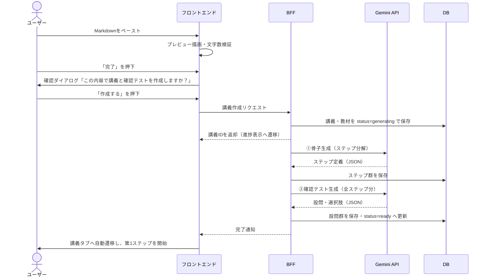
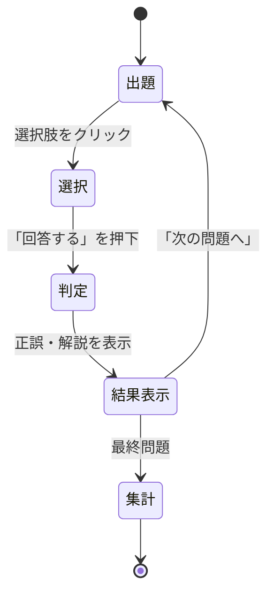

# 要件定義書：機能要件（§4）

[目次へ戻る](../REQUIREMENTS.md)

## 4. 機能要件

### 4.1 講義作成（SC-03 オーバーレイ）

講義の作成はタブではなくオーバーレイとして提供する。タブ（B-1）は選択中の講義に対するビューを切り替える機構であり、新しい講義を作る操作はそこに属さないためである。起動導線は A-2「⊕ 新規講義」と SC-02 の「教材をアップロード」の2つで、いずれも同じ状態でこの画面を開く。

#### 4.1.1 画面要素

| 要素 | 仕様 |
|---|---|
| 閉じるボタン（`✕`） | オーバーレイを閉じる。Esc キーでも同じ動作とする。入力内容は破棄しない |
| 講義タイトル入力欄 | 任意入力。未入力の場合、骨子生成時にAIが教材内容から命名する（§5.2） |
| 教材入力欄 | 複数行テキストエリア。ペーストを主たる入力手段とする。ラベルと補助文で Markdown を前提としない（Q-28） |
| 補助文 | 入力欄の直下に「Markdown 記法に対応しています」を置く。記法を使える利用者に向けた案内であり、必須の前提としては書かない。プレーンテキストで足りることはプレースホルダと §4.8 のガイドで伝える（Q-28） |
| 使い方ガイドへの導線 | 講義タイトル入力欄の直下に「使い方を見る」を置き、SC-17 を開く（§4.8）。ヘッダーの隅では、詰まっている利用者の視線に入らない |
| プレビュー欄 | 入力欄の内容をリアルタイムにレンダリング。左右2ペイン構成 |
| 文字数カウンタ | 現在の文字数と上限を表示 |
| 「完了」ボタン | 押下で確認ダイアログを表示 |

#### 4.1.2 入力制約

| 制約 | 値 | 根拠 |
|---|---|---|
| 最小文字数 | 500文字 | これ未満ではステップ分解が成立しない |
| 最大文字数 | 80,000文字（確定） | 教材全文をプロンプトに載せる設計のため、コンテキスト長とAPIコストから設定。日本語の場合おおよそ8万〜10万トークンに相当する。Gemini のコンテキスト長（100万トークン）に対して十分な余裕があり、かつ長文コンテキストの割増料金が適用される20万トークンの境界にも達しない値 |
| 形式 | Markdown（プレーンテキストも許容） | 記法を知らない利用者を排除しないため。この許容は UI 上も読み取れる必要があり、入力欄は Markdown を必須と見せない（§4.1.1、Q-28） |

上限超過時は「完了」ボタンを非活性にし、超過文字数を表示する。

**実測後も80,000文字で据え置く（2026-08-27）。** Q-16 の実測により、80,000文字は約40,000トークンと判明し、当初の想定より余裕が大きいことが分かった。引き上げ余地としては、D1 の行サイズ上限1MB から約30万文字、§8.2.1 の割増境界（20万トークン）から約40万文字までが技術的な限界である。ただし上限を上げれば1講義あたりのコストが比例して増え、§8.2.3 の月間上限に直結するため、MVP では据え置く。

#### 4.1.3 レンダリング仕様

| 記法 | 対応 |
|---|---|
| 見出し、リスト、表、コードブロック、引用、強調、リンク | 対応する |
| 数式（LaTeX） | **対応する（必須）**。インライン記法（`$...$`）とブロック記法（`$$...$$`）の双方に対応する |
| 生HTML | サニタイズして除去する（XSS対策、§8.3）。ただし数式レンダラが出力するHTMLは許可対象とするため、サニタイズ設定は数式用タグ・属性のホワイトリストを含めること |
| 画像 | 外部URLのみ表示。ローカル画像の添付はMVP対象外 |

数式レンダリングは講義作成オーバーレイのプレビューに限らず、**教材タブ（§4.4）・講義チャットのAI発話（§4.2）・確認テストの問題文・選択肢・解説（§4.3）にも同一の処理を適用する**。教材に数式が含まれる以上、AIの解説にも数式が現れるため、レンダリング対象を教材プレビューに限定すると解説が読めなくなる。

#### 4.1.4 講義作成フロー



#### 4.1.5 確認ダイアログ

- 文言：「この内容で講義と確認テストを作成しますか？」
- ボタン：「作成する」／「キャンセル」
- 「キャンセル」押下時は入力内容を保持したままオーバーレイに留まる。
- オーバーレイを `✕` / Esc で閉じた場合も入力内容は保持し、次に A-2 から開いたときに復元する。8万文字規模のペーストを誤操作で失う損失が、書きかけが残ることによる混乱より大きいためである。作成が完了した時点で入力内容は破棄する。

#### 4.1.6 生成中および失敗時の扱い

| 状態 | 表示 |
|---|---|
| 生成中 | 進捗インジケータと現在の処理段階（「ステップに分解しています」→「確認テストを作成しています」）を表示。所要時間の目安を併記する |
| 骨子生成失敗 | 講義を作成せず、エラー内容と再試行ボタンを表示。入力内容は保持する |
| 確認テスト生成失敗 | 骨子は保存済みのため講義自体は利用可能とし、確認テストタブに「テストの生成に失敗しました／再生成する」を表示する |
| 途中離脱 | 生成はサーバー側で継続する。再訪時に status に応じた画面を表示する |

#### 4.1.7 既存講義に対する再アップロード

MVPでは、1講義に対する教材の差し替え・追記は行わない。内容を変えたい場合は新規講義として作成する。

### 4.2 講義タブ

#### 4.2.1 基本仕様

- チャット形式。AIの発話（講義本文）とユーザーの発話（質問・応答）を時系列に表示する。
- 発話はステップに紐づけて保存し、ステップ境界には区切りを表示する。
- AIの応答はストリーミング表示する（§8.1）。

#### 4.2.2 ステップの進行

| # | 挙動 |
|---|---|
| 1 | 講義を開いた時点で、未完了の最初のステップの講義本文を生成・表示する |
| 2 | 講義本文は、1ステップを複数の発話に分割して段階的に提示する。各分割の末尾でユーザーへの理解確認または問いかけを行い、応答を待つ |
| 3 | ステップの解説が完了したら、AIが要約を提示し「次のステップへ進む」ことを促す |
| 4 | ユーザーが進行に同意した時点で、当該ステップを完了状態に更新し、次ステップの本文生成へ移る |
| 5 | 全ステップ完了時、確認テストタブへの誘導を表示する。この時点で AI は新たな発話を行わない |
| 6 | 全ステップ完了後も質問は受け付ける（§4.2.4、Q-32） |

ステップ完了の判定は**ユーザーが次へ進むことに同意した時点**とする（確定）。確認テストの通過を完了条件には含めない。

この結果、講義タブと確認テストタブは互いに独立して進行できる。確認テストは理解度の測定手段であって進行のゲートではなく、ユーザーは全ステップを通して受講した後に任意のタイミングでテストを受けられる。

#### 4.2.3 進捗状況パネル（C-1）

進捗状況パネルは講義タブ専用の要素であり、講義タブを開いている間のみ右上に表示する。教材タブおよび確認テストタブでは表示しない。


| 表示要素 | 仕様 |
|---|---|
| ステップ一覧 | 全ステップのタイトルを順序どおり表示 |
| 完了ステップ | チェックアイコン付きで表示 |
| 現在のステップ | 強調表示 |
| 未着手ステップ | 淡色で表示 |
| 全体進捗 | 「2 / 4 ステップ完了」の形式で表示 |
| 操作 | 完了済みステップをクリックすると、その時点の対話ログを閲覧できる（読み取り専用） |

#### 4.2.4 質問応答

| 項目 | 仕様 |
|---|---|
| 入力 | 画面下部のプロンプト入力欄（E-1） |
| 回答方針 | 教材の該当箇所を根拠に回答する。教材に記載のない事項を補足する場合は、教材外の情報である旨を明示する |
| 脱線の扱い | 現在のステップから大きく外れた質問には回答した上で、本筋へ戻る導線を提示する |
| 先取り質問 | 後続ステップの内容に関する質問には、簡潔に回答した上で「ステップNで詳しく扱う」旨を伝える |
| 履歴の扱い | 同一ステップ内の対話は全て文脈に含める。過去ステップは要約を文脈に含める（§5.4） |
| 全ステップ完了後 | **入力欄は開いたままとし、質問応答（④）だけを受け付ける。** 講義本文（③）は生成しない。発言は最後のステップに紐づけ、回答の範囲は講義全体とする（Q-32） |

#### 4.2.5 空状態

講義が1件も存在しない場合、講義タブは「まず教材をアップロードしてください」と講義作成オーバーレイ（SC-03）への導線を表示する。この空状態は教材タブ・確認テストタブでも同じものを表示する。

### 4.3 確認テストタブ

#### 4.3.1 出題仕様

| 項目 | 仕様 |
|---|---|
| 形式 | 選択式・**4択**・単一正答 |
| 出題単位 | **講義単位を基本とする。** 設問は必ずしもステップと1対1で対応しない（下記4.3.1.1） |
| 問題数 | 講義全体で10〜30問。教材の分量に応じてAIが決定する |
| 選択肢の順序 | 保存時にシャッフルし、正解位置の偏りを排除する |
| 出題順 | **受験のたびにシャッフルする。** 出題順の記憶による見かけ上の正答率向上を防ぐため |

##### 4.3.1.1 設問とステップの関係

設問はステップに従属せず、**講義に従属する**。個々の設問は次のいずれかの形を取る。

| 種別 | 説明 |
|---|---|
| 単一ステップ設問 | 特定の1ステップの内容のみで解ける設問。関連ステップを1つ持つ |
| 横断設問 | 複数ステップの内容を組み合わせないと解けない設問。関連ステップを複数持つ |

横断設問を許容する理由は、ステップ単位に閉じた設問だけでは「各ステップを個別に暗記したが全体として使えない」状態を検出できないためである。理解度の測定という目的に照らすと、横断設問は単一ステップ設問より測定力が高い。

設問はステップとの関連情報（関連ステップの集合）を保持し、確認テストタブではこれを用いてステップによる絞り込みを行える。ただし絞り込みは任意であり、既定は講義全体からの出題とする。

#### 4.3.2 解答フロー



- 1問ごとに即座に正誤と解説を表示する（都度フィードバック方式）。
- 解答は選択の都度ではなく「回答する」押下時に確定し、確定後の変更は不可とする。
- 全問終了後、正答率・誤答一覧・「誤答のみ再挑戦」への導線を表示する。

#### 4.3.3 正誤記録

- 解答は1回ごとに解答記録として永続化する（上書きではなく追記）。これにより、同一設問の複数回挑戦の履歴が残る。
- 設問ごとの表示状態は「最新の解答記録」に基づく。

#### 4.3.4 復習モード

| 項目 | 仕様 |
|---|---|
| 対象 | 「最新の解答記録が誤答である設問」を抽出する |
| 起動 | 確認テストタブの「誤答のみに取り組む」ボタン、または結果画面の導線 |
| 挙動 | 通常出題と同一。正答すれば当該設問は対象から外れる |
| 空の場合 | 「誤答した問題はありません」と表示する |

#### 4.3.5 確認テストの再生成

**MVPには含めない（確定）。** 再生成は既存の解答記録との紐付けを失わせるため、履歴の整合性を保つ実装が必要になる一方、設問品質は §5.3 の生成要件と検証で担保する方針を取る。将来拡張として §11.2 に記載する。

### 4.4 教材タブ

選択中の講義に紐づく教材（Markdown原文）を読み取り専用で表示するタブである。講義タブ・確認テストタブと同じく「選択中の講義に対するビュー」であり、この3つでタブバー（B-1）を構成する。

| 項目 | 仕様 |
|---|---|
| 表示対象 | 選択中の講義の教材原文。1講義に教材は1つ紐づく（§2） |
| レンダリング | §4.1.3 と同一の規則（数式・コードブロック・表・サニタイズ）を適用する |
| 編集 | **行わない。** 差し替え・追記も対象外とし、内容を変えたい場合は新規講義として作成する（§4.1.7） |
| ヘッダー | 講義タイトル、文字数、読み取り専用である旨を表示する |
| 生成中・失敗時 | 教材は講義作成時に保存済みであるため、`status` が `generating` / `failed` であっても表示する。SC-05 / SC-06 は講義タブ側の画面である |
| 講義0件時 | SC-02（空状態）を表示する（§4.2.5） |
| 進捗パネル・入力欄 | いずれも表示しない（§3.4） |

このタブを設ける理由は、講義チャットが教材の全文を提示しない（ステップに分解して要点を解説する）ため、原典を確認したい場面が生じることにある。教材はユーザー自身が所有する資料であり手元にも存在しうるが、アプリ内に保存済みの原文へ参照経路がないと、AIの解説と教材の記述を突き合わせる操作が成立しない。

MVPでは検索・目次・ステップとの相互リンクは設けない。これらは教材の構造化（見出しとステップの対応付け）を前提とし、§5.2 の骨子生成が返す情報だけでは position を特定できないためである。将来拡張として §11.2 に記載する。

### 4.5 講義管理

| 機能 | 仕様 |
|---|---|
| 新規作成 | 「⊕ 新規講義」ボタン（A-2）から講義作成オーバーレイ（SC-03）へ |
| 一覧 | サイドバー（A-3）。タイトルと進捗率を表示 |
| 切替 | クリックで選択講義を変更。タブは講義タブに切り替わり、進捗パネルも連動する |
| リネーム | 対応する（右クリックメニューまたは⋯メニュー） |
| 複製 | 対応する（Q-30）。確認ダイアログ（SC-18）を表示し、**教材・ステップ分割・確認テストの設問を引き継いだ講義**を新しく作る。対話ログ・解答記録・ステップの進行状況は引き継がない。AI を呼ばないため、月間の講義作成数（§8.2.3）は消費しない（あの件数は①骨子生成の回数で数える）。複製できるのは `status=ready` の講義に限る |
| 削除 | 対応する。確認ダイアログを表示し、関連するステップ・メッセージ・設問・解答記録を全て削除する |
| 生成中の表示 | status=generating の講義は一覧に表示するが、選択時は生成中画面を表示する |

### 4.6 認証

| 項目 | 仕様 |
|---|---|
| 目的 | 講義・進捗・解答記録をユーザーに紐づけて永続化すること。MVPでは利用者を絞る手段も兼ねる |
| 方式 | **Googleアカウントによるサインイン（OAuth 2.0 / OpenID Connect）**。加えて、運営が発行するID・パスワードによる**ゲストサインイン**を提供する（Q-26）。他のプロバイダによる認証は提供しない |
| 未ログイン時 | ログイン画面のみ表示し、他機能は利用不可 |
| 認可 | 全てのデータアクセスにおいて、リクエスト元ユーザーの所有物であることをサーバー側で検証する |
| 利用者制限 | MVPでは許可リスト方式でログイン可能なアカウントを制限する。APIコストが利用者数に比例するため（§8.2）。ゲストは発行済みのIDのみが対象であり、許可リストとは別系統で管理する |
| 許可リストの保持 | D1 の `allowed_emails` テーブルに置き、`npm run allow:add` / `allow:list` / `allow:remove` で操作する。判定はサインインの時点で行うため、削除しても発行済みのセッションは有効期限まで残る |
| ゲストの発行 | 運営がコマンドで発行する（`npm run guest:add`）。パスワードは8文字を自動生成し、発行時にのみ表示する。保存するのは PBKDF2-SHA256 の導出鍵のみで、平文は保持しない |
| 総当たりへの備え | ゲストは10回連続で失敗すると15分間ロックする。「IDが存在しない」と「パスワードが違う」は同一の応答とし、IDの存在確認に使わせない |

### 4.7 運営管理ページ

利用者・費用・認証の状態を1箇所で確認するための、運営専用の画面（Q-27）。

| 項目 | 仕様 |
|---|---|
| 目的 | 誰が使っていて、費用がどこで発生し、認証まわりに異常が無いかを確認すること。個々の値は既存のテーブルに揃っているが、コマンドと Workers Observability に分散しており、横断して見る手段が無かった |
| 経路 | `/admin`。利用者向けの画面遷移（§9）には現れず、SC番号も持たない |
| 権限 | `users.is_admin`。判定はリクエストのたびに DB を参照する。セッション（JWT）に載せると、権限を外しても発行済みのトークンが期限（30日）まで管理者のまま残るため。付与・取り消しは `npm run admin:add` / `admin:list` / `admin:remove` |
| 範囲 | **段階1は読み取りのみ。** 許可リストの追加、ゲストの発行、上限値とシステムプロンプトの変更は従来どおりコマンドとコードで行う |
| 内容 | 概要（利用者数・講義数・当月と累計の費用・エラー件数）／利用者（上限に対する消費、講義・AI呼び出し・ログインの詳細）／AI呼び出しログ／ログイン記録／認証（許可リスト・ゲスト）／設定（モデルID・上限値・システムプロンプト） |
| ログイン記録 | `access_logs` を新設し、成功・拒否・失敗・ロック中の試行をすべて残す。従来は `guest_accounts.last_login_at` しか無く、Google の利用者は最終ログインすら記録していなかった |
| IPの保持 | **残す。** §8.2.3 の上限は利用者ごとに数えるため、発行したゲストIDを複数人で使い回されると費用がその人数分だけ積み上がる（Q-26）。離れた回線からの同一IDのログインは、IP無しでは検知する手段が無い。取得元は Cloudflare が付ける `cf-connecting-ip` とし、経路上で足せる `X-Forwarded-For` は見ない |
| User-Agentの保持 | **残さない。** 自己申告であり偽装できるうえ、身内利用では判明しても打つ手が無い。得られるものが無いまま個人に紐づく情報だけが増える |
| システムプロンプトの扱い | **表示のみ。** ソースの引き写しではなく、サーバーが実際に組み立てた文字列を返す（引数で変わる箇所はソースを読んでも確定しないため）。Web からの編集を段階1に含めないのは、壊れると①〜⑤の生成が全滅し、その事実が生成失敗としてしか現れないため |
| 秘密の扱い | APIキー・セッション鍵・OAuth のクライアント秘密は返さない（§8.3 SEC-1）。ゲストの導出鍵とソルトも返さない |

---

### 4.8 使い方ガイド（SC-17）

このアプリの使い方を、アプリの中で解決するための画面（Q-29）。想定する利用者には Markdown を知らない
者が含まれ、講義作成（§4.1）で「Markdown が何か分からない」「手元にあるのは授業スライドの PDF で、
貼り付けられるテキストが無い」といった理由で止まることが最も起きやすい。ここで止まると講義を1つも
作れないまま離脱するため、他のどの機能よりも先に塞ぐ価値がある。

| 項目 | 仕様 |
|---|---|
| 目的 | 最初の講義を作れないまま離脱することを防ぐ。詰まる原因のうち UI の文言で先回りできるものは §4.1.1 で消し、それでも残る疑問をこの画面で受ける |
| 経路 | SC-17。サイドバー（A-6）、講義作成オーバーレイ（SC-03）の講義タイトル入力欄の直下、空状態（SC-02）の3箇所から開く。実際に詰まるのは §4.1 の最中であり、サイドバーだけに置くと詰まっている本人の視界に入らない |
| 範囲 | **段階1は定型回答のみ。自由入力欄を持たず、AI を呼ばない**（Q-29） |
| 形式 | チャット形式。質問の候補をチップで並べ、押すと質問と回答が発言として積まれる |
| 回答の所在 | クライアント側の静的データ。サーバーへ要求を出さない |
| 認証 | 不要。サーバーへ行かないため、サンプル表示（§4.6）でも同じものが見える |
| 状態の保存 | しない。閉じると初期状態に戻る。テーブルの追加を伴わない |
| 上限との関係 | 無関係。AI を呼ばないため §8.2.3 の消費に影響しない |

**アコーディオン形式の FAQ ではなくチャット形式にする理由**：段階2で自由入力と AI の回答を足す場合、
チャット形式であれば入力欄を1つ増やすだけで済み、画面を作り直さずに移行できる。機能としては段階1の
時点で FAQ と等価であり、この選択は将来の移行コストのみを根拠とする。

**「AIに質問する」と名乗らない理由**：段階1は AI を呼ばない。AI と名乗ると利用者は自由入力を探し、
候補以外に答えないことに気づいて失望する。画面名は「使い方」とし、できることと名前を一致させる。

#### 4.8.1 質問候補

| 質問 | 回答の要点 | 関連 |
|---|---|---|
| Markdown ってなに？ | 知らなくても使えることが結論。記号の無いテキストでも講義は作れる。使うなら `#`（見出し）と `-`（箇条書き）で足りる | §4.1.2 |
| PDF の資料を使いたい | §4.8.2 の手順を示す | §11.1 |
| Word や PowerPoint の資料を使いたい | 本文を選択してコピーし、そのまま貼り付ければよい。図が主体の場合は §4.8.2 と同じ手順へ誘導する | — |
| どれくらいの分量を入れればいい？ | 500〜80,000文字。教科書1章分が目安 | §4.1.2 |
| どんな教材だとうまくいく？ | 章単位で区切る。目次だけ、スライドの箇条書きだけといった、本文の無いものは避ける | §5.2 |
| 作成にどれくらい時間がかかる？ | 3分程度。閉じても作成は続く | §4.1.6、§7.4 |
| 何回まで作れる？ | 種別ごとの月間上限。残りはサイドバーの利用状況（A-5）で確認できる | §8.2.3 |
| 数式や図は表示される？ | 数式は表示される。画像は外部URLのみで、貼り付けたファイルは扱えない | §4.1.3 |

回答は文章で持ち、講義本文と同じレンダリング（§4.1.3）を通す。上表の「関連」列は回答文が参照する
仕様であり、値を変える際はガイドの文言も併せて直す必要があることを示す。

#### 4.8.2 PDF 資料への回答

PDF を受け付けない理由は §11.1 のとおり実装上の未対応であるが、利用者から見れば「手元の資料が使え
ない」という同じ結果になる。そこで、外部の生成AIで Markdown へ変換してもらう手順を提示する。回答は
文章ではなく、**変換用プロンプトをコピーできる形**で示す。非エンジニアにコードブロックの範囲選択を
させると、そこが新たな脱落点になるためである。

提示する文面：

> お使いの生成AI（ChatGPT・Gemini・Claude など）に PDF を添付し、次の文章を送ってください。
> 返ってきたテキストをそのまま貼り付ければ、講義を作れます。

```
添付したPDFの内容を、学習用のテキストとして書き起こしてください。

条件:
- 前置きや感想を書かず、書き起こした本文だけを出力する
- 内容を要約せず、書かれていることをそのまま残す
- 見出しは # ## ###、箇条書きは - で表す
- 表は Markdown の表として書く
- 数式は文中なら $...$、独立した行なら $$...$$ で書く
- 図やグラフは画像にできないので、何を示しているかを文章で説明する
```

> 途中で出力が止まったら「続きを出力してください」と送ってください。

このプロンプトが指定している各条件には、いずれも根拠がある。

| 条件 | 根拠 |
|---|---|
| 前置きを書かせない | 「変換しました」等が混ざると、そのまま貼り付けた教材に指示文が残り、§5.2 の骨子生成が本文と誤認する |
| 要約させない | 要約されると §4.1.2 の最小文字数を割り、ステップ分解が成立しない |
| 数式を `$...$` / `$$...$$` で書かせる | この指定が無いと画像や独自記法で返り、§4.1.3 で対応済みの数式レンダリングが働かない |
| 図を文章で説明させる | 画像は外部URLのみ対応であり（§4.1.3）、貼り付けたファイルは表示できない |
| 続きを促す案内を添える | 授業スライド1回分でも出力が上限に達して途切れることがあり、利用者はそれを異常だと受け取る |

#### 4.8.3 段階2として保留したもの

| 項目 | 保留する理由 |
|---|---|
| 自由入力と AI による回答 | ①費用の計上先が未定である。ヘルプでの AI 呼び出しを §8.2.3 の枠に含めるか別枠にするかを決めないと、ゲスト（月 $3）の上限に穴が開く。②アプリと無関係な用途の汎用チャットとして使われる余地がある。③候補以外に何が聞かれるかを観測してからでないと、AI に何を答えさせるべきかが決まらない |
| 聞かれた質問の記録 | 上記③のための観測手段だが、利用者の入力を保存する以上テーブルの追加と保持方針の決定を伴う。段階1の「サーバーへ行かない」という性質を失うため、必要になった時点で別途決める |
