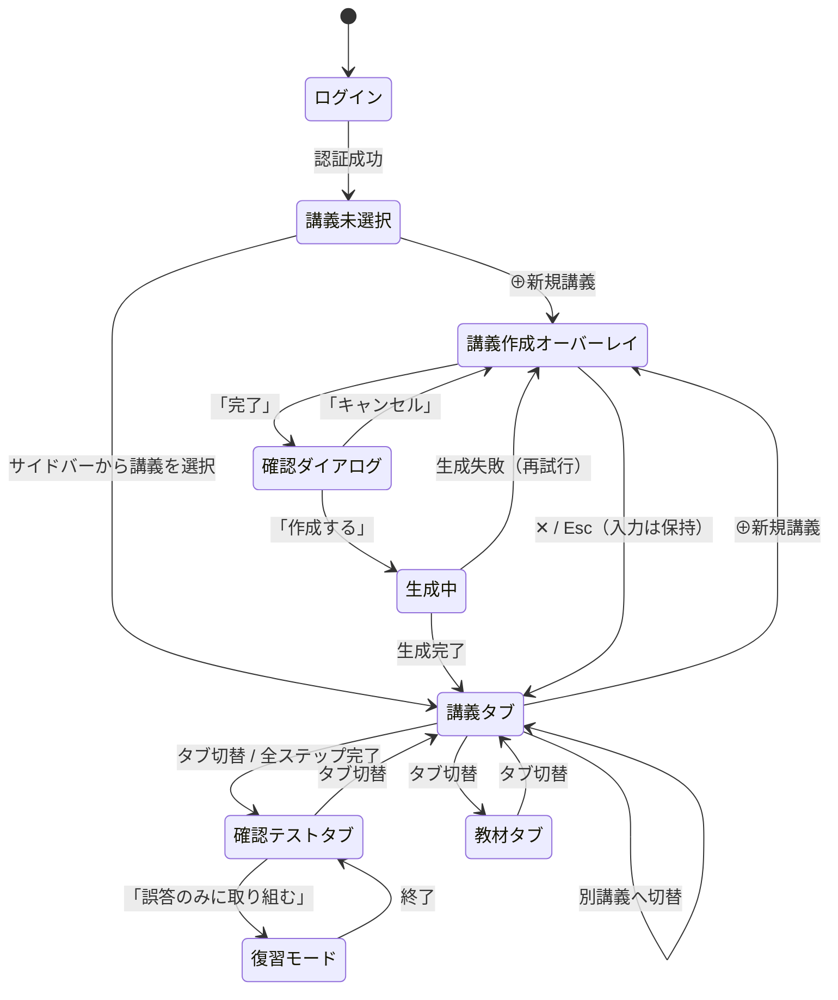

# 要件定義書：画面構成・画面遷移（§3・§9）

[目次へ戻る](../REQUIREMENTS.md)

## 3. 画面構成

本章は**存在するすべての画面**を列挙し、各画面の表示要素・表示条件・遷移を定める。画面の抜けが無いことを保証するのが目的である。

配置の見た目は実装（`app/src/screens/`）を正とする。初版はワイヤーフレーム（`UIラフ.JPG`）を出発点に ASCII の模式図を載せていたが、実装と二重に保守する必要があり、ずれやすいため削除した（2026-11-09）。

### 3.1 画面一覧

| ID | 画面 | タブ | 進捗パネル | 入力欄 | 備考 |
|---|---|---|---|---|---|
| SC-01 | ログイン | — | — | — | 未認証時 |
| SC-02 | 空状態（講義0件） | 全タブ共通 | 非表示 | 非表示 | 初回ログイン直後 |
| SC-03 | 講義作成オーバーレイ | —（タブを覆う） | 非表示 | 非表示 | 教材入力＋プレビュー |
| SC-04 | 作成確認ダイアログ | —（タブを覆う） | 非表示 | 非表示 | 「完了」押下時 |
| SC-05 | 生成中 | 講義 | 非表示 | 非表示 | `status=generating` |
| SC-06 | 生成失敗 | 講義 | 非表示 | 非表示 | `status=failed` |
| SC-07 | 講義タブ | 講義 | **表示** | **表示** | 主画面 |
| SC-08 | 確認テスト／開始画面 | 確認テスト | 非表示 | 非表示 | 出題範囲の選択 |
| SC-09 | 確認テスト／出題中 | 確認テスト | 非表示 | 非表示 | 4択 |
| SC-10 | 確認テスト／正誤と解説 | 確認テスト | 非表示 | 非表示 | 都度フィードバック |
| SC-11 | 確認テスト／結果集計 | 確認テスト | 非表示 | 非表示 | 正答率・誤答一覧 |
| SC-12 | 復習モード／対象なし | 確認テスト | 非表示 | 非表示 | 誤答0件時 |
| SC-13 | 講義メニュー | — | — | — | サイドバーの `⋯` |
| SC-14 | 削除確認ダイアログ | — | — | — | 講義削除時 |
| SC-15 | ユーザーメニュー | — | — | — | ログアウト |
| SC-16 | 教材タブ | 教材 | 非表示 | 非表示 | 教材原文の読み取り専用表示 |
| SC-17 | 使い方ガイド | —（タブを覆う） | 非表示 | 非表示 | 定型回答のみ。AIを呼ばない（§4.8） |
| SC-18 | 複製確認ダイアログ | — | — | — | 講義複製時（§4.5） |
| SC-M01〜M05 | モバイル各画面 | — | — | — | §3.3 |

**復習モードの出題中・正誤表示・結果集計は、SC-09〜SC-11 と同一のレイアウトを用いる**（ヘッダーに「復習モード」と対象問数を表示する点のみが異なる）。そのため独立した画面としては数えない。

### 3.2 デスクトップの画面

幅1024px以上で適用する。

**SC-01 ログイン画面（デスクトップ／モバイル共通）**

- 未認証時はこの画面のみを表示し、他の機能へは遷移できない（§4.6）
- 「Googleでサインイン」に加え、ゲストサインイン（ID・パスワード、Q-26）と、ログインせずにサンプル講義を操作できる「画面を見る」（`/?demo`）を置く
- サイドバー・タブバー・進捗パネルはいずれも表示しない
- 許可リストに含まれないアカウントでサインインした場合は、その旨を表示してサインアウトする

**SC-02 空状態（講義0件）**

- 初回ログイン直後の状態
- 講義タブ・確認テストタブを開いてもこの画面を表示する（§4.2.5）
- 進捗状況パネルは表示しない（対象となる講義がないため）

**SC-03 講義作成オーバーレイ**

- タブではなく、A-2「⊕ 新規講義」または SC-02 の導線から開く一時的な画面（§4.1）
- サイドバーは残し、タブバーとメイン領域を覆う。`✕` または Esc で閉じ、入力内容は保持する（§4.1.5）
- 左右2ペイン。左に教材入力、右にリアルタイムプレビュー（§4.1.1）
- 文字数カウンタは現在値と上限を表示。500文字未満または80,000文字超で「完了」を非活性にする（§4.1.2）
- 数式・コードブロック・表をプレビューで描画する（§4.1.3）
- 講義タイトル入力欄の直下に使い方ガイド（SC-17）への導線を置く。詰まるのはこの画面の中であり、教材を貼り付ける直前の位置が最も目に入るため（§4.8）
- 進捗状況パネルと入力欄は表示しない

**SC-04 作成確認ダイアログ**

- 「完了」押下で表示する（§4.1.5）
- 「キャンセル」で入力内容を保持したまま SC-03 へ戻る
- 「作成する」で講義作成ジョブを起動し、SC-05 へ遷移する

**SC-05 生成中**

- 処理段階を2段階で表示する（§4.1.6、§7.4）
- サイドバーの当該講義には「生成中」を表示する（§4.5）
- 画面を離れてもジョブは継続する。再訪時は `status` に応じた画面を表示する
- フロントエンドは2秒間隔でポーリングする（§7.4）

**SC-06 生成失敗**

- `status=failed` の講義を選択したときに表示する
- エラー内容を提示する（§4.1.6、§5.7）
- 骨子生成のみ成功していた場合はこの画面ではなく講義タブを表示し、確認テストタブに再生成の導線を出す

**SC-07 講義タブ**

- チャット形式で講義が進行する。AI応答はストリーミング表示（§4.2.1、§8.1）
- 右上に進捗状況パネル（C-1）。完了ステップに ✓、現在のステップに ▸ を表示（§4.2.3）
- 下部にプロンプト入力欄（E-1）。質問はここから送信する（§4.2.4）
- 完了済みステップをクリックすると、その時点の対話ログを読み取り専用で閲覧できる
- ステップ境界には区切りを表示する

**SC-08 確認テストタブ／開始画面**

- **進捗状況パネルと入力欄は表示しない**（いずれも講義タブ専用。§3.4）
- 既定は講義全体からの出題。ステップによる絞り込みは任意（§4.3.1.1）
- 設問はステップに1対1で対応しないため、絞り込みの合計は総問数と一致しないことがある（横断設問が複数ステップに現れるため）
- 「誤答のみに取り組む」で復習モードへ入る（§4.3.4）

**SC-09 確認テストタブ／出題中**

- 4択・単一正答（§4.3.1）
- 選択肢は保存時にシャッフル済み。**出題順は受験のたびにシャッフルする**（Q-6）
- 選択肢をクリックして選び、「回答する」で確定する。確定後の変更は不可（§4.3.2）
- 選択肢の文体・長さ・粒度は揃える（§5.3 R-4）

**SC-10 確認テストタブ／正誤と解説**

- 1問ごとに即座に正誤と解説を表示する（都度フィードバック方式。§4.3.2）
- 正解の選択肢と、自分が選んだ選択肢の双方を明示する
- 解説は生成時に設問へ付与済み（§5.3 R-5）。ここで追加のAI呼び出しは行わない
- この時点で解答記録を1件追記する（§4.3.3）

**SC-11 確認テストタブ／結果集計**

- 正答率、誤答一覧、復習モードへの導線を表示する（§4.3.2）
- 誤答項目をクリックすると当該設問の解説を再表示する

**SC-12 復習モード／対象なし**

- 最新の解答記録が誤答である設問が0件のときに表示する（§4.3.4）

**SC-16 教材タブ**

- 選択中の講義に紐づく教材の原文を、講義タブと同一のレンダリング規則で表示する（§4.1.3）
- **読み取り専用**。編集・差し替えは行わない（§4.1.7）
- 教材は講義作成時に保存済みであるため、`status` が `generating` / `failed` であっても表示する（§4.4）
- 進捗状況パネルと入力欄は表示しない

### 3.3 モバイルの画面

**モバイル対応はMVPに含める（Q-1）。**

| ブレークポイント | 呼称 | 方針 |
|---|---|---|
| 1024px以上 | デスクトップ | §3.2 のレイアウトを適用 |
| 768〜1023px | タブレット | サイドバーをドロワーへ格納。それ以外はデスクトップに準じる |
| 767px以下 | モバイル | 下表のとおり再構成する |

**モバイル時の再構成**

| 領域 | モバイルでの扱い |
|---|---|
| サイドバー（A-1〜A-4） | ハンバーガーメニューからのドロワー（SC-M03）。講義選択後は自動的に閉じる |
| タブ切替（B-1） | **画面下部に固定したタブバー**へ移動する。上部固定では親指が届かず、モバイルの標準的な操作と乖離するため |
| 進捗状況パネル（C-1） | 講義タブのヘッダー下に1行で折りたたみ表示し、タップで全ステップ一覧を展開する（SC-M01 / SC-M02） |
| プロンプト入力欄（E-1） | 画面下部に固定。ソフトキーボード表示時は Visual Viewport API で入力欄が隠れないよう追従させる |
| 講義作成オーバーレイの2ペイン | 左右分割をやめ、「入力」「プレビュー」のトグル切替とする（SC-M04） |
| 教材タブ（SC-16） | 全幅1カラムでそのまま表示する。デスクトップと構造上の差異はない |
| コードブロック・数式・表 | 横スクロール可能なコンテナに収め、ページ全体が横スクロールしないようにする |
| 確認テストの選択肢 | 縦積みの全幅ボタンとし、タップ領域を44px以上確保する（SC-M05） |

**下部の競合（Q-15 の決定）**

講義タブでは、タブバー（B-1）とプロンプト入力欄（E-1）がいずれも画面下部を占める。ソフトキーボード表示時の可視領域は400px程度で、ヘッダー56px・進捗折りたたみ行40px・入力欄56px・タブバー56px を差し引くとチャットに残るのは約190px（3〜4行）となり、解説を読みながら質問するという講義タブの使い方が成立しない。

**キーボード表示中はタブバーを隠す（確定）。**

| 項目 | 仕様 |
|---|---|
| 条件 | プロンプト入力欄がフォーカスされ、ソフトキーボードが表示されている間 |
| 挙動 | タブバーを非表示にし、入力欄を画面下端へ寄せる。キーボードが閉じたらタブバーを復帰させる |
| 検知 | Visual Viewport API（入力欄の追従に用いるものと同一） |
| 根拠 | 文字入力中にタブを切り替える操作は実質発生しない。またスクロール方向で出し入れする方式（下方向スクロールで隠す等）は、講義タブが上へ遡って読み返す操作を多く含むため、意図しない出入りが起きて煩わしい |

タブバーの表示状態は「ソフトキーボードの有無」のみで決まる。それ以外の要因（スクロール方向、経過時間など）で出し入れしない。

以下に、デスクトップと構造が異なる画面を示す。ここに挙げていない画面（SC-01・SC-02・SC-04〜SC-06・SC-08・SC-10〜SC-12・SC-16）は、上表の再構成規則をそのまま適用したものとなり、構造上の差異が生じない。

**SC-M01 講義タブ（進捗パネル折りたたみ）**

- **タブバーは画面下部に固定**する。上部固定では親指が届かないため（§3.3）
- 進捗状況パネルはヘッダー下の1行に折りたたむ。`▾` をタップで SC-M02 へ展開する
- プロンプト入力欄は下部固定。ソフトキーボード表示時は Visual Viewport API で追従させる

**SC-M02 講義タブ（進捗パネル展開）**

- 折りたたみ行をタップすると全ステップ一覧を展開する
- 展開中もチャットは背後に残り、再度タップで閉じる

**SC-M03 サイドバー（ドロワー）**

- ヘッダーの ☰ をタップで左から表示する（§3.3）
- 講義を選択すると自動的に閉じ、講義タブへ切り替わる（§4.5）
- 各行の `⋯` から SC-13（リネーム／削除）を開く

**SC-M04 講義作成オーバーレイ**

- **左右2ペインをやめ、「入力／プレビュー」のトグル切替**にする（§3.3）
- タブバー・進捗パネル・プロンプト入力欄をいずれも覆い、画面全体を占める
- `✕` または Esc で閉じる。入力内容は保持する（§4.1.5）

**SC-M05 確認テストタブ（出題中）**

- 選択肢は縦積みの全幅ボタン。**タップ領域を44px以上確保する**（§3.3）
- 選択肢の文字数によっては折り返す。長い選択肢でも全文を表示し、省略しない
- 進捗パネルと入力欄は表示しない

### 3.4 共通領域の仕様

| ID | 領域 | 内容 | 表示条件 |
|---|---|---|---|
| **A-1** | サイドバー最上部 | アプリ名「AI講師」 | 常時（モバイルはドロワー内） |
| **A-2** | サイドバー | 「⊕ 新規講義」ボタン。押下で講義作成オーバーレイ（SC-03）を開く。書きかけの入力がある場合はそれを復元する | 常時 |
| **A-3** | サイドバー | 講義一覧。更新日時の降順。クリックで当該講義を選択状態にする。選択中の講義はハイライトする | 常時（0件時は空状態メッセージ） |
| **A-4** | サイドバー最下部 | ユーザーアイコンとユーザー名。クリックで SC-15 を表示 | ログイン時のみ |
| **A-5** | サイドバー（A-4 の直上） | 今月の利用状況。「AI利用額」と「講義作成」の消費を上限に対する割合として帯で示す（§8.2.4） | ログイン時のみ（利用状況を取得できるまでは非表示） |
| **A-6** | サイドバー（A-5 の直上） | 「使い方」ボタン。押下で使い方ガイド（SC-17）を開く（§4.8） | 常時 |
| **B-1** | タブ切替 | 教材／講義／確認テスト。いずれも選択中の講義に対するビューであり、講義の新規作成は含まない | 常時（デスクトップは上部中央、モバイルは下部固定） |
| **C-1** | 進捗状況パネル | ステップ一覧と完了状態を表示 | **講義タブを開いている場合のみ**。教材タブ・確認テストタブでは表示しない |
| **D-1** | メイン領域 | タブに応じたコンテンツ | 常時 |
| **E-1** | プロンプト入力欄 | 質問・応答の入力 | 講義タブでのみ表示 |

### 3.5 ダイアログ・メニュー

**SC-13 講義メニュー**

- サイドバーの各講義の `⋯` から開く（§4.5）
- 「名前を変更」はその場で編集可能にする
- 「複製」は SC-18 を表示する
- 「削除」は SC-14 を表示する

**SC-14 削除確認ダイアログ**

- 関連するステップ・メッセージ・設問・解答記録をすべて削除する（§4.5）
- 復元手段は用意しない

**SC-15 ユーザーメニュー**

- サイドバー最下部のユーザー行（A-4）から開く
- MVPではログアウトのみ。設定項目は持たない

**SC-18 複製確認ダイアログ**

- 複製の内容と、上限を消費しないことを明示する（§4.5、Q-30）
- 失敗（費用上限・生成中の講義）はダイアログを閉じずにこの中へ理由を出す。メニューから即時に実行すると、失敗を伝える場所が無くなる

---

## 9. 画面遷移図

